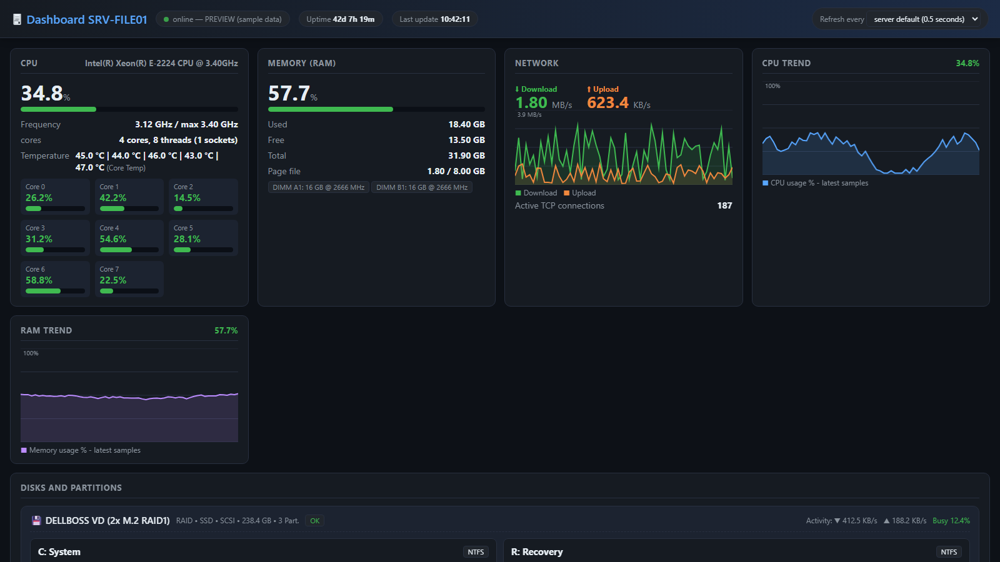
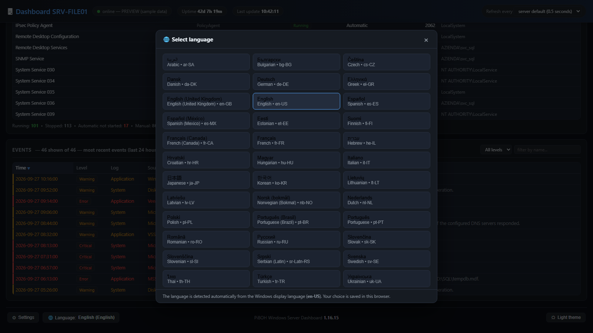
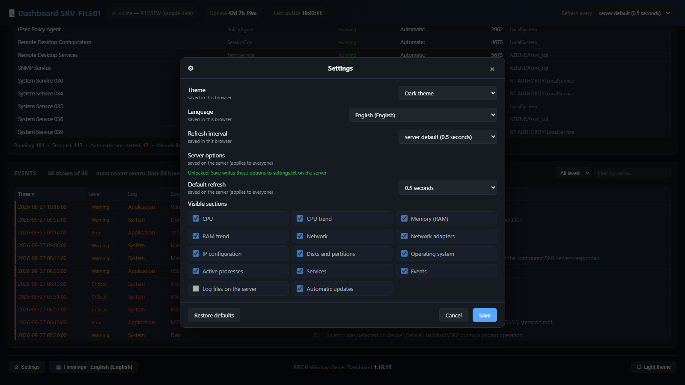

<div align="center">


# windows-server-dashboard

**A web dashboard for Windows Server that installs with one double click.**

No agent, no IIS, no external module, no database: a single PowerShell script
publishes the page, and you open it from any computer on the LAN by typing the
IP of the server.

[](Changelog/CHANGELOG.md)
[](#requirements)
[](#requirements)
[](#-38-languages)
[](LICENSE)



</div>

---

## Why

Every small server ends up with the same question: *what is it doing right now?*
The usual answers are a heavy monitoring suite, an agent to install and keep
updated, or Remote Desktop and Task Manager. This project is the boring middle
ground: copy a folder, run `Install.bat`, and from then on the machine publishes
its own status page on port 8080.

It runs as a scheduled task called **PiBOH Windows Server Dashboard**, under
`SYSTEM`, starting **at boot**: the server can sit at the lock screen forever,
nobody needs to log on. The task carries a description explaining what it is,
and the software announces itself in the Windows event log at every start.

## What it shows

| Section | Details |
|---|---|
| **CPU** | total load, per-core bars, real clock speed, socket/core/thread count, temperature, trend chart |
| **Memory** | used / free / total, page file, installed modules (slot, size, speed), trend chart |
| **Disks** | one box per physical disk with bus and media type, containing its partitions: space used, file system and live read / write / busy per partition |
| **Network** | live download and upload with a colour legend on the chart (green = download, orange = upload), per-adapter figures, link speed, MAC, active TCP connections |
| **IP configuration** | IPv4, mask, gateway, DNS, IPv6, DHCP, per adapter |
| **Operating system** | Windows release (23H2, 25H2, ...), version and revision, build, manufacturer, model, BIOS, serial, install date, last boot, uptime, sessions |
| **Processes** | every process with the friendly name from the file ("Windows Explorer" for `explorer.exe`) as the main line and, right under it, the real image name (`sqlservr.exe`); PID, CPU %, RAM, threads, handles, full path in the tooltip; the dashboard's own row is highlighted so it can be spotted while scrolling |
| **Services** | the complete list with state, startup type, PID and log-on account |
| **Events** | critical, error and warning entries of the System and Application logs of the last 24 hours |

Tables sort by clicking the column headers, File Explorer style, and the choice
is remembered by the browser. The Process column sorts by the name it shows,
the friendly name, and the process table opens in that order (A to Z) instead
of by CPU: with two hundred rows, a list that reorders itself at every refresh
is hard to read.

## Quick start

```text
1. Copy the folder to the server, for example  C:\ServerDashboard\
2. Right-click Install.bat  ->  Run as administrator
3. When asked, type the optional password (or Enter for none) and choose
   what it protects: the whole page or only the server options
4. From any PC on the LAN:  http://<server-ip>:8080
```

The installer checks the machine first, applies only what is missing and prints
every change with its **BEFORE** and **AFTER** value:

```text
 [+] Firewall rule "PiBOH Windows Server Dashboard 8080"
     BEFORE : not present  |  AFTER : created (inbound, TCP 8080)
 [=] URL reservation http://+:8080/
     BEFORE : already reserved  |  AFTER : unchanged
 [+] Scheduled task "ServerDashboard"
     BEFORE : not present  |  AFTER : created, runs at boot as SYSTEM

 [OK] AUTOSTART VERIFIED - no interactive logon needed
```

`Uninstall.bat` puts everything back exactly as it was, including a scheduled
task that happened to have the same name.

## Highlights

- **Zero dependencies** — `System.Net.HttpListener`, part of Windows. IIS is not
  installed and port 80 is left alone.
- **Light on the server** — metrics are sampled in tiers (CPU/RAM/network every
  cycle, processes every 5 s, disks every 10 s, services every 30 s, events every
  60 s) and **when nobody is watching the collector stops sampling completely**,
  waking up within 250 ms of the first request. Since 1.16.6 nothing loads the
  Storage, NetAdapter or NetTCPIP module any more (the disk and network metrics
  come from the same WMI classes those cmdlets read, but without paying for the
  modules), and the JSON the browsers receive is built once per cycle instead of
  once per request. On a Windows 11 machine with Core Temp running and a browser
  refreshing every 0.5 s, over nine minutes, Task Manager's Memory column went
  from 35.5-203.9 MB to 15.2-127.1 MB and private bytes from 202.7-239.7 MB to
  156.0-159.8 MB.
- **Live by default**: the refresh interval is **0.5 s** out of the box and can
  be set per browser from 0.5 s to 5 min; the server only sets the default.
- **Light and dark theme**, dark by default, saved per browser.
- **About panel** — click the version in the footer: who wrote it, the
  portfolio, the e-mail, and the changelog read from GitHub every time the
  panel opens, never cached, so it always shows the published history.
- **Works on any localized Windows** — every metric comes from CIM/WMI classes
  whose property names are always English.
- **Read-only by design** — the page only displays: no command can be executed
  on the server. The only thing a visitor can write is the dashboard's own
  options (default interval, visible sections, logging, automatic updates),
  from the settings panel. With no password set anyone who can see the page can
  change them; the optional password (`.config-do-not-delete-me\pwd`, asked by
  the installer) is what limits that: **total** closes the whole page behind a
  login, **partial** leaves the page open and locks only the server options,
  unlocked by a popup the moment one of them is clicked.

## 🌐 38 languages

The interface is translated into every language Windows Server 2016 ships as a
display language. It opens in the language of Windows, and each visitor can pick
another one from the footer; the choice is personal and saved in their browser.

<div align="center"></div>

```text
ar-SA  bg-BG  cs-CZ  da-DK  de-DE  el-GR  en-GB  en-US  es-ES  es-MX  et-EE
fi-FI  fr-CA  fr-FR  he-IL  hr-HR  hu-HU  it-IT  ja-JP  ko-KR  lt-LT  lv-LV
nb-NO  nl-NL  pl-PL  pt-BR  pt-PT  ro-RO  ru-RU  sk-SK  sl-SI  sr-Latn-RS
sv-SE  th-TH  tr-TR  uk-UA  zh-CN  zh-TW
```

Arabic and Hebrew switch the layout to right-to-left. Adding a language means
copying one XML file into `lang\` and translating the strings: it shows up in the
picker by itself.

## Settings

<div align="center"></div>

| Option | Stored where | Who can change it |
|---|---|---|
| Theme | browser cache | every visitor |
| Language | browser cache | every visitor |
| Refresh interval | browser cache | every visitor |
| Default interval | `settings.txt` | the settings panel: everyone, unless a password is set |
| Visible sections | `settings.txt` | the settings panel: everyone, unless a password is set |
| Logging on/off | `settings.txt` | the settings panel: everyone, unless a password is set |
| Automatic updates | `settings.txt` | the settings panel: everyone, unless a password is set |

`settings.txt` is a plain text file you edit with Notepad, and the same options
are in the settings panel of the page: with no password set, whoever is looking
at the dashboard can change them and Save writes them back into this file. With
a password set, a visitor has to type it first. Changes are picked up within ten
seconds, no restart needed, and every write is logged with the address it came
from. A request coming from another site's page is refused, so a page you happen
to have open cannot reconfigure the server behind your back.

## Layout

```text
windows-server-dashboard\
├── Install.bat            install and start (as administrator)
├── Uninstall.bat          undo exactly what the installer changed
├── Start-Dashboard.bat    manual start, installs nothing
├── Stop-Dashboard.bat     stop it
├── settings.txt           server settings (auto-created, editable with Notepad)
├── scripts\               the engine, the updater and the helper scripts
│   └── version.txt        the version: the single source of truth
├── lang\                  the 38 translations
├── screenshots\           the images used by this page
├── Changelog\             CHANGELOG.md + release-notes\ (one file per release)
├── docs\                  manual, logo, offline preview
└── logs\                  one log file per day (auto-created)
```

The repository also carries `_build\`: the dashboard page is edited there
as three files (`web\page.html`, `web\page.css`, `web\page.js`) and
`Embed-Page.ps1` writes the two copies there are out of them - the page
spliced into the engine, which is what ships, and the offline preview in
`docs\`, adding the preview block (`preview\preview.js`: sample data, the 38
dictionaries, the answers that stand in for the server) and the version from
`scripts\version.txt`. `Embed-Page.ps1 -Check` fails when either copy is not
what the sources produce, and the syntax check runs it on every push. That
folder is not part of the package: the release archive leaves it out and the
updater never copies it onto a server.

## Self update

At every start - the scheduled task runs at boot as SYSTEM, so **no logon is
needed** - the dashboard reads
[`scripts/version.txt`](scripts/version.txt) from the `main` branch of this
repository. When the remote version is newer it downloads the release tagged
`v<version>`, unpacks it and copies it over the current files, **never
touching `settings.txt` or the logs**, then restarts itself on the new version.
Everything is written to the log, and to the Windows event log under the source
*PiBOH Windows Server Dashboard*.

Since 1.16.4 each release also records its build commit, so republishing the
same version updates every dashboard too, and `scripts\Update-Now.bat` now
restarts itself as administrator - stopping and restarting the scheduled
task needs those rights.

```text
auto_update = no        in settings.txt  -> disable it
scripts\Update-Now.bat                   -> check, stop, update, restart
```

Because of this mechanism, releases must always be tagged `v<version>`
(for example `v1.16.0`).

## Try it without a server

Open **[`docs/Dashboard-Preview.html`](docs/Dashboard-Preview.html)** in any
browser: it is the real interface filled with sample data, all 38 languages and
both themes included. Nothing is installed and no network is used: the settings
panel behaves as it does on a server with no password, so Save changes the page
itself and writes nothing anywhere. It is generated from the same sources as
the served page (`_build\Embed-Page.ps1`), so it cannot lag behind it.

## Requirements

- Windows Server 2016 or newer (works on Windows 10/11 too)
- PowerShell 5.1, the one already in the box
- Administrator rights for the installation only
- 32-bit and 64-bit Windows both work: it is one script, run by
  whichever Windows PowerShell is installed
- CPU temperature needs a sensor: BIOS/ACPI, or just
  [Core Temp](https://www.alcpu.com/CoreTemp/) running (the plain program, 32-bit or
  64-bit - no add-on, its own CSV log works too), LibreHardwareMonitor or
  HWiNFO; the page always names the source it used

## Troubleshooting

Run **`scripts\Diagnose.bat`** as administrator: it changes nothing and reports
the state of the scheduled task, whether the process runs and under which
account, what is listening on the port, the URL reservation, the firewall rule,
how the disks were detected and the last lines of the log, ending with a verdict:

```text
>>> STARTS WITHOUT INTERACTIVE LOGON : YES
```

If it says `NO`, `scripts\Repair-Autostart.bat` rebuilds the task and the URL
reservation without reinstalling.

## Documentation

- [Manual](docs/README.md) — every option explained, in ten short chapters
- [Changelog](Changelog/CHANGELOG.md) — Semantic Versioning, from 1.0.0 to today

## Security note

The dashboard has no authentication: anyone who can reach port 8080 sees the
data. No command can be run through it, but the server options can be changed
from the panel by whoever can see the page until a password is set, so if the
server is exposed to the Internet either set one or restrict the rule to your
subnet. A write coming from another site's page is refused and logged, so an
open browser tab cannot change the options; a program that speaks HTTP by
itself still can, and that is what the password is for:

```bat
netsh advfirewall firewall set rule ^
      name="PiBOH Windows Server Dashboard 8080" ^
      new remoteip=192.168.1.0/24
```

## License

[MIT](LICENSE) — do what you like with it, a mention is appreciated.
